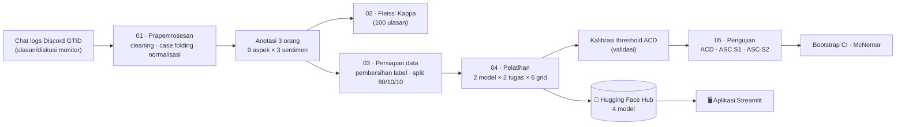

<div align="center">

# Implementasi Aspect-Based Sentiment Analysis (ABSA) Berbasis IndoBERT untuk Pemetaan Keluhan pada Ulasan Produk Monitor

**Skripsi · Program Studi Ilmu Komputer · Jurusan Matematika · FMIPA · Universitas Negeri Medan**


[🤗 Model di Hugging Face](#-model-di-hugging-face) · [📊 Hasil](#-hasil-utama) · [🔬 Tahapan Penelitian](#-tahapan-penelitian) · [▶️ Reproduksi](#️-cara-mereproduksi) · [🖥️ Aplikasi Streamlit](https://github.com/loudersyoakim/absa-streamlit-app)

</div>

---

## Daftar Isi

1. [Ringkasan](#-ringkasan)
2. [Hasil Utama](#-hasil-utama)
3. [Model di Hugging Face](#-model-di-hugging-face)
4. [Alur Penelitian](#-alur-penelitian)
5. [Struktur Repositori](#-struktur-repositori)
6. [Tahapan Penelitian (Detail)](#-tahapan-penelitian)
7. [Cara Mereproduksi](#️-cara-mereproduksi)
8. [Menggunakan Model](#-menggunakan-model)
9. [Keterbatasan](#-keterbatasan)
10. [Etika Data](#-etika-data)
11. [Sitasi dan Kontak](#-sitasi-dan-kontak)

---

## 📌 Ringkasan

Ulasan produk monitor berbahasa Indonesia bersifat teknis dan **multi-aspek**: satu kalimat dapat memuji kualitas layar sekaligus mengeluhkan pengiriman. Analisis sentimen konvensional hanya memberi **satu label per dokumen**, sehingga keluhan spesifik tertutup oleh pujian lain.

Repositori ini memuat seluruh kode, notebook, dan artefak evaluasi penelitian yang menerapkan **Aspect-Based Sentiment Analysis (ABSA)** dalam dua tahap:

| Tahap | Tugas | Jenis | Keluaran |
|---|---|---|---|
| **ACD** | *Aspect Category Detection* | Multi-label, 9 kategori aspek, aktivasi **Sigmoid** + threshold | Aspek apa saja yang dibahas ulasan |
| **ASC** | *Aspect Sentiment Classification* | Single-label, 3 kelas, aktivasi **Softmax** | Sentimen (Positif / Netral / Negatif) untuk tiap aspek |

Dua arsitektur dibandingkan pada kedua tugas dengan alur pelatihan dan pengujian yang identik:

- **IndoBERT** (`indobenchmark/indobert-base-p2`), model utama
- **mBERT** (`bert-base-multilingual-cased`), model pembanding (*baseline*)

Total **4 model hasil fine-tuning** (2 arsitektur × 2 tugas), seluruhnya dipublikasikan di Hugging Face dan dipakai oleh [aplikasi Streamlit](https://github.com/loudersyoakim/absa-streamlit-app).

**Contoh keluaran ABSA**

> *“Layarnya jernih, harga oke, namun pengiriman sangat lama.”*

| Aspek terdeteksi (ACD) | Sentimen (ASC) |
|---|---|
| A1 · Kinerja Visual | Positif |
| C2 · Harga & Nilai | Positif |
| C1 · Pengemasan & Pengiriman | **Negatif** |

---

## 📊 Hasil Utama

Seluruh angka berikut dihitung pada **data uji (333 ulasan unik / 588 pasangan ulasan–aspek)** yang baru dibuka pada `05_testing.ipynb` dan tidak pernah dipakai saat pelatihan, validasi, maupun kalibrasi threshold.

### ACD (multi-label, 9 aspek)

| Metrik | IndoBERT | mBERT |
|---|:---:|:---:|
| Threshold optimal (dari validasi) | 0,45 | 0,30 |
| **F1-Micro** | **0,8900** | 0,8753 |
| **F1-Macro** | **0,8523** | 0,8417 |
| Precision-Macro | **0,8661** | 0,8276 |
| Recall-Macro | 0,8467 | **0,8630** |
| Hamming Loss (↓ lebih baik) | **0,0427** | 0,0497 |
| Exact-match (*subset accuracy*) | **0,7057** | 0,6847 |

### ASC · Skenario 1 (aspek *ground-truth*)

| Metrik | IndoBERT | mBERT |
|---|:---:|:---:|
| Accuracy (= F1-Micro) | **0,9082** | 0,8963 |
| F1-Macro | **0,9074** | 0,8956 |
| F1 kelas Negatif | **0,95** | 0,93 |
| F1 kelas Netral | **0,88** | 0,87 |
| F1 kelas Positif | **0,90** | 0,89 |

### ASC · Skenario 2 (*end-to-end*, aspek dari hasil ACD)

| Metrik | IndoBERT | mBERT |
|---|:---:|:---:|
| F1-Macro (27 pasangan aspek–sentimen) | **0,7915** | 0,7645 |
| F1-Micro | **0,8196** | 0,7883 |
| Exact-match | **0,6006** | 0,5676 |
| Penurunan F1-Macro vs skenario 1 | −0,1160 (−12,8%) | −0,1311 (−14,6%) |

> Penurunan antar-skenario adalah ***cascading error***: aspek yang terlewat atau salah terdeteksi pada ACD ikut membawa kesalahan ke ASC.

### Interval kepercayaan 95% (bootstrap, 1.000 iterasi, F1-Macro)

| Tugas / skenario | IndoBERT | mBERT |
|---|:---:|:---:|
| ACD | 0,823 – 0,877 | 0,815 – 0,866 |
| ASC skenario 1 | 0,883 – 0,931 | 0,869 – 0,920 |
| ASC skenario 2 | 0,751 – 0,817 | 0,730 – 0,789 |

### Uji McNemar (IndoBERT vs mBERT, data uji yang sama)

| Pengujian | p-value | Kesimpulan (α = 0,05) |
|---|:---:|---|
| ACD · aspek **D1** (Umum) | **0,0026** | ✅ Signifikan (19 ulasan benar hanya di IndoBERT vs 4 hanya di mBERT) |
| ACD · exact-match seluruh label | 0,2100 | Tidak signifikan |
| ACD · aspek A1–C2 (8 aspek) | 0,125 – 1,000 | Tidak signifikan |
| ASC skenario 1 | 0,3240 | Tidak signifikan |

**Cara membaca:** IndoBERT unggul secara numerik pada mayoritas metrik agregat, tetapi selisihnya kecil dan **hanya signifikan secara statistik pada aspek D1**. mBERT tetap kompetitif (mis. Recall-Macro ACD lebih tinggi dan F1 sentimen lebih tinggi pada aspek A2, B1, B3, D1). Ukuran data uji (333 ulasan) membatasi daya statistik.

### F1-Macro ASC skenario 1 per aspek

| Aspek | IndoBERT | mBERT | Aspek | IndoBERT | mBERT |
|---|:---:|:---:|---|:---:|:---:|
| A1 Kinerja Visual | **0,917** | 0,893 | B3 Akurasi Informasi | 0,867 | **0,878** |
| A2 Keandalan & Cacat | 0,941 | **0,973** | C1 Pengemasan & Pengiriman | **0,954** | 0,924 |
| A3 Desain & Fitur | **0,940** | 0,939 | C2 Harga & Nilai | **0,808** | 0,766 |
| B1 Komunikasi Penjual | 0,886 | **0,898** | D1 Umum | 0,904 | **0,955** |
| B2 Layanan Purna Jual | **0,984** | 0,939 | | | |

---

## 🤗 Model di Hugging Face

Bobot model **tidak disimpan di repositori ini** (ukuran ±500–700 MB per checkpoint). Seluruhnya tersedia di Hugging Face Hub:

| Model | Tugas | Basis | Hyperparameter terbaik | Hugging Face |
|---|---|---|---|---|
| IndoBERT ACD | Deteksi kategori aspek (multi-label) | `indobenchmark/indobert-base-p2` | batch 16 · LR 3e-5 · 5 epoch · threshold 0,45 | [`loudersyoakim/absa-indobert-acd`](https://huggingface.co/loudersyoakim/absa-indobert-acd) |
| IndoBERT ASC | Klasifikasi sentimen per aspek | `indobenchmark/indobert-base-p2` | batch 16 · LR 2e-5 · 5 epoch | [`loudersyoakim/absa-indobert-asc`](https://huggingface.co/loudersyoakim/absa-indobert-asc) |
| mBERT ACD | Deteksi kategori aspek (multi-label) | `bert-base-multilingual-cased` | batch 16 · LR 5e-5 · 5 epoch · threshold 0,30 | [`loudersyoakim/absa-mbert-acd`](https://huggingface.co/loudersyoakim/absa-mbert-acd) |
| mBERT ASC | Klasifikasi sentimen per aspek | `bert-base-multilingual-cased` | batch 16 · LR 2e-5 · 5 epoch | [`loudersyoakim/absa-mbert-asc`](https://huggingface.co/loudersyoakim/absa-mbert-asc) |

Contoh pemakaian ada di bagian [Menggunakan Model](#-menggunakan-model).

---

## 🧭 Alur Penelitian



---

## 📁 Struktur Repositori

```text
absa-louders-yoakim-telaumbanua/
├── data/
│   ├── raw/                 # dataset.csv (ulasan mentah, pemisah ';')
│   ├── processed/           # dataset_preprocessed.csv, data_clean.xlsx
│   ├── annotations/         # data_uji_kappa.xlsx, hasil anotasi, dataset_labelled.xlsx
│   └── splits/              # train.csv · val.csv · test.csv (format long)
├── src/
│   ├── kamuskatabaku.xlsx   # kamus kata baku (eksternal)
│   ├── kamus_kata_baku2.csv # kamus typo/normalisasi manual
│   └── kamus_teknis.csv     # kamus jargon teknis monitor
├── notebooks/
│   ├── 01_preprocessing.ipynb
│   ├── 02_fleiss_kappa.ipynb
│   ├── 03_data_preparation.ipynb
│   ├── 04_training.ipynb
│   └── 05_testing.ipynb
├── model/
│   ├── label_maps.json
│   ├── acd_optimal_thresholds.json
│   ├── training_summary.json
│   ├── hyperparam_search_results.csv
│   └── evaluation/          # CSV metrik + figures/ (confusion matrix)
├── requirements.txt
└── README.md
```

> Sebagian berkas dalam `data/` dan `model/` dapat tidak disertakan di repositori (lihat `.gitignore`) karena ukuran atau pertimbangan data. Bobot model ada di [Hugging Face](#-model-di-hugging-face).

Notebook **harus dijalankan berurutan** (01 → 05) dan memakai path relatif `../data`, `../src`, `../model`, sehingga dijalankan dari dalam folder `notebooks/`.

---

## 🔬 Tahapan Penelitian

### Tahap 0 · Pengumpulan data

| Item | Keterangan |
|---|---|
| Sumber | Arsip diskusi (*chat logs*) komunitas **Discord GTID** tentang produk monitor |
| Akses | Diperoleh dengan izin tertulis pengelola; identitas pengguna dianonimkan |
| Bahasa | Indonesia informal dengan jargon teknis dan campuran istilah Inggris (*code-mixing*) |
| Penyaringan | ±8.000 baris mentah → 5.401 (pembersihan awal) → 3.329 (seleksi relevansi) → **3.326 ulasan bersih** |

### Tahap 1 · Prapemrosesan · [`01_preprocessing.ipynb`](notebooks/01_preprocessing.ipynb)

Input `data/raw/dataset.csv` (3.329 baris, kolom `No` dan `Ulasan`). Fungsi `text_preprocessing()` menerapkan urutan berikut:

1. **Case folding**: seluruh teks diubah ke huruf kecil.
2. **Pembersihan**: karakter non-alfanumerik (tanda baca, emoji, simbol) diganti spasi, lalu spasi berlebih dirapikan.
3. **Normalisasi jargon teknis**: variasi penulisan dipetakan ke bentuk standar dengan regex berbatas kata (`\b…\b`), misalnya `144hz`, `144 hz`, `144hert` → `144Hz`. Sumber: `src/kamus_teknis.csv`.
4. **Normalisasi kata baku dan typo** per kata, dari gabungan dua kamus: `src/kamuskatabaku.xlsx` (kamus baku eksternal) dan `src/kamus_kata_baku2.csv` (typo manual), misalnya `hallo → halo`, `kaka → kakak`.
5. **Pembuangan baris kosong** setelah pembersihan (3.329 → **3.326 baris**).
6. **Pemeriksaan kembar**: dicari ulasan yang teksnya identik setelah normalisasi (ditemukan 4 baris / 2 pasangan, misalnya `Goodd` dan `Good👍👍👍` sama-sama menjadi `bagus`).

Keluaran:

- `data/processed/dataset_preprocessed.csv`: kolom `Ulasan` (asli) dan `Ulasan_Cleaned`.
- `data/processed/data_clean.xlsx`: bahan untuk **anotasi** (kolom `No`, `Ulasan`).
- `data/annotations/data_uji_kappa.xlsx`: **100 ulasan pertama** (No 1–100) untuk uji kesepakatan antar-anotator.

### Tahap 2 · Skema aspek dan pedoman pelabelan

Sembilan kategori aspek disusun dari studi literatur ABSA produk elektronik dan observasi diskusi komunitas monitor:

| Kelompok | Kode | Aspek | Cakupan |
|---|---|---|---|
| **Produk** | A1 | Kinerja Visual | Kualitas panel saat normal: resolusi, warna, *refresh rate*, *ghosting*, kecerahan |
| | A2 | Keandalan & Cacat Produk | *Dead pixel*, *backlight bleed*, kestabilan jangka panjang, fungsi elektronik |
| | A3 | Desain, Kualitas Fisik & Fitur | *Build quality*, ergonomi (stand/bracket), port, fitur tambahan, aksesoris |
| **Layanan** | B1 | Komunikasi & Dukungan Penjual | Kecepatan respons, keramahan, profesionalisme penjual |
| | B2 | Layanan Purna Jual | Klaim garansi, retur, penanganan komplain pasca-beli |
| | B3 | Akurasi Informasi Produk | Kesesuaian deskripsi/foto etalase dengan unit yang diterima |
| **Transaksi** | C1 | Pengemasan & Pengiriman | Standar packing, keamanan dan ketepatan waktu kirim |
| | C2 | Harga & Nilai | Persepsi harga vs fitur, kewajaran harga, promo |
| **Lainnya** | D1 | Umum | Ungkapan umum tanpa rujukan objek spesifik (salam, terima kasih) |

Satu ulasan dapat memuat **beberapa aspek**, masing-masing dengan **satu sentimen**: `Positif`, `Negatif`, atau `Netral`. Hasil anotasi disimpan dalam **format long** (satu baris = satu pasangan ulasan–aspek–sentimen).

### Tahap 3 · Reliabilitas anotasi · [`02_fleiss_kappa.ipynb`](notebooks/02_fleiss_kappa.ipynb)

- **3 anotator** melabeli **100 ulasan** secara independen.
- Setiap sel dikodekan sebagai `0` (aspek tidak dibicarakan), `1` Positif, `2` Negatif, `3` Netral; sehingga Kappa menilai kesepakatan atas **ada-tidaknya aspek sekaligus polaritasnya**.
- Kappa dihitung **per aspek** dengan `statsmodels` (`aggregate_raters` + `fleiss_kappa`) dan ditafsirkan memakai skala Landis & Koch (1977).

| A1 | A2 | A3 | B1 | B2 | B3 | C1 | C2 | D1 | **Rata-rata** |
|:---:|:---:|:---:|:---:|:---:|:---:|:---:|:---:|:---:|:---:|
| 0,9606 | 0,9269 | 0,9093 | 0,9698 | 1,0000 | 0,9621 | 0,9748 | 1,0000 | **0,5673** | **0,9190** |

Delapan dari sembilan aspek berada pada kategori **Hampir Sempurna** (> 0,81). **D1 (Umum)** hanya **Moderat** (0,5673) karena batasnya tipis dan subjektif, dan kelak juga menjadi aspek tersulit bagi model.

### Tahap 4 · Persiapan data dan pembagian · [`03_data_preparation.ipynb`](notebooks/03_data_preparation.ipynb)

**Pembersihan label** pada `data/annotations/dataset_labelled.xlsx` (6.016 baris):

1. Buang baris dengan `Ulasan`, `Aspek`, atau `Sentimen` kosong (0 baris).
2. Seragamkan penulisan: `Sentimen` → huruf kapital di awal, `Aspek` → huruf besar.
3. Pertahankan hanya sentimen sah `{Positif, Negatif, Netral}` (0 baris dibuang).
4. Buang duplikat `(Ulasan, Aspek)`, `keep='first'` (**31 baris** dibuang).

Hasil: **5.985 pasangan ulasan–aspek–sentimen** dari **3.324 ulasan unik** (dua ulasan identik pasca-normalisasi menyatu).

**Pembagian data** dilakukan pada level **ulasan unik**, bukan pada level baris, agar seluruh aspek dari satu ulasan **tidak terpecah** ke himpunan berbeda (mencegah kebocoran data antar-split):

- Setiap ulasan diberi satu label stratifikasi, yaitu **sentimen modus** dari baris-barisnya.
- `train_test_split` 80 : 20 terstratifikasi (`random_state=42`), lalu sisa 20% dibagi 50 : 50 menjadi validasi dan uji.
- Ulasan dipetakan kembali ke format long.

| Himpunan | Ulasan unik | Baris (ulasan–aspek) |
|---|:---:|:---:|
| Latih (`train.csv`) | 2.659 | 4.794 |
| Validasi (`val.csv`) | 332 | 603 |
| Uji (`test.csv`) | 333 | 588 |

Tidak dilakukan *oversampling*, *undersampling*, maupun augmentasi teks pada notebook ini; data dipakai apa adanya. Distribusi aspek tidak seimbang (aspek terbanyak **C2**: 889 kemunculan, 14,9%; paling sedikit **D1**: 269, 4,5%), sehingga evaluasi melaporkan **F1-Macro** di samping F1-Micro.

### Tahap 5 · Pelatihan model · [`04_training.ipynb`](notebooks/04_training.ipynb)

**Ruang label** dikunci dan disimpan di `model/label_maps.json` agar urutan indeks tidak berubah antar tahap:

```json
{"aspect_labels": ["A1","A2","A3","B1","B2","B3","C1","C2","D1"],
 "sentiment_labels": ["Negatif","Netral","Positif"]}
```

**Penyiapan input per tugas**

| | ACD | ASC |
|---|---|---|
| Unit data | Ulasan unik (data long diagregasi per ulasan) | Satu baris long = satu *instance* |
| Input model | `[CLS] ulasan [SEP]` | `[CLS] ulasan [SEP] kode_aspek [SEP]` (*sentence-pair*, mis. `… [SEP] C1 [SEP]`) |
| Target | Vektor *multi-hot* 9 dimensi (`MultiLabelBinarizer`, kelas dikunci) | ID sentimen 0/1/2 |
| `problem_type` | `multi_label_classification` → **BCEWithLogitsLoss** (Sigmoid + BCE) | `single_label_classification` → **CrossEntropyLoss** (Softmax) |
| Jumlah data latih / validasi | 2.659 / 332 | 4.794 / 603 |

**Tokenisasi.** Setiap model memakai tokenizer-nya sendiri. `max_length` ditentukan **secara data-driven**: persentil ke-95 panjang token data latih, dibatasi maksimum 128. Hasilnya: IndoBERT 26 (ACD) dan 26 (ASC); mBERT 37 (ACD) dan 38 (ASC). Padding dinamis lewat `DataCollatorWithPadding`.

**Pencarian hyperparameter (grid).** Rekomendasi Devlin et al. (2019):

| Hyperparameter | Nilai |
|---|---|
| Batch size | 16, 32 |
| Learning rate | 2e-5, 3e-5, 5e-5 |
| Epoch | 5 (tetap) |
| Optimizer | AdamW (`adamw_torch`, bawaan `Trainer`) |
| Seed | 42 (Python, NumPy, PyTorch, CUDA) |

6 kombinasi × 2 model × 2 tugas = **24 proses fine-tuning**. Untuk tiap kombinasi, checkpoint terbaik dipilih per epoch berdasarkan **Macro-F1 validasi** (`load_best_model_at_end`), lalu kombinasi terbaik dipilih dari 6 kandidat dengan metrik yang sama. Seluruh log disimpan di `model/hyperparam_search_results.csv`.

| Model · Tugas | Hyperparameter terbaik | Macro-F1 validasi |
|---|---|:---:|
| IndoBERT · ACD | batch 16 · LR 3e-5 | 0,8756 (0,8778 pada threshold 0,45) |
| IndoBERT · ASC | batch 16 · LR 2e-5 | 0,9015 |
| mBERT · ACD | batch 16 · LR 5e-5 | 0,8680 (0,8699 pada threshold 0,30) |
| mBERT · ASC | batch 16 · LR 2e-5 | 0,8864 |

**Kalibrasi threshold ACD.** Selama pelatihan, ACD dipantau dengan threshold sementara 0,5. Setelah model terbaik terpilih, threshold optimal dicari **per model** pada **data validasi** (kandidat 0,05–0,95, langkah 0,05) yang memaksimalkan Macro-F1: **IndoBERT 0,45** dan **mBERT 0,30**. Hasilnya disimpan di `model/acd_optimal_thresholds.json`.

**Artefak.** Tokenizer dan checkpoint terbaik tiap (model, tugas) disimpan di `model/{model}_{task}/best_model/`, beserta ringkasan `model/training_summary.json` (hyperparameter, skor validasi, `max_length`). Lingkungan pelatihan: Google Colab dengan GPU.

### Tahap 6 · Pengujian dan evaluasi · [`05_testing.ipynb`](notebooks/05_testing.ipynb)

Notebook ini **pertama kali membuka `test.csv`** dan memuat keempat model beserta threshold dari tahap 5.

**Tiga skenario pengujian**

| Skenario | Cara kerja | Yang diukur |
|---|---|---|
| **ACD** | Prediksi 9 probabilitas Sigmoid, dibiner dengan threshold per model | Kemampuan mendeteksi aspek |
| **ASC · Skenario 1** | Kode aspek yang diberikan ke model adalah **label sebenarnya** | Kemampuan murni memahami polaritas |
| **ASC · Skenario 2** | Kode aspek berasal dari **prediksi ACD**; tiap aspek terdeteksi dikirim ke ASC | Kinerja sistem *end-to-end* termasuk *cascading error* |

Pada skenario 2, hasil dibandingkan dengan kebenaran dalam bentuk matriks **27 dimensi** (9 aspek × 3 sentimen) per ulasan. Sebuah pasangan benar hanya jika aspeknya terdeteksi **dan** polaritasnya tepat.

**Metrik:** Accuracy, Precision/Recall/F1 (Micro dan Macro), Hamming Loss, exact-match (*subset accuracy*), *confusion matrix* biner per aspek (ACD) dan 3×3 (ASC; keseluruhan dan per aspek).

> Pada ASC skenario 1 (single-label), F1-Micro **identik** dengan Accuracy. Pada ACD (multi-label) keduanya berbeda, sehingga exact-match dilaporkan terpisah.

**Validasi statistik**

- **Bootstrap:** resampling dengan pengembalian dari data uji, 1.000 iterasi, persentil 2,5 dan 97,5 → interval kepercayaan 95% untuk Macro-F1 (`seed=42`).
- **Uji McNemar** berpasangan IndoBERT vs mBERT pada indikator benar/salah per instance (uji eksak binomial bila pasangan diskordan kecil): ACD exact-match, ACD per aspek (9 uji), dan ASC skenario 1.

Seluruh keluaran tersimpan di `model/evaluation/`:

| Berkas | Isi |
|---|---|
| `acd_test_metrics.csv` | Metrik ACD kedua model |
| `asc_scenario1_test_metrics.csv` | Metrik ASC skenario 1 |
| `asc_scenario1_per_aspect_metrics.csv` | Macro-F1 dan accuracy ASC per aspek |
| `asc_scenario2_test_metrics.csv` | Metrik ASC *end-to-end* |
| `asc_scenario_comparison.csv` | Selisih skenario 1 vs 2 (*cascading error*) |
| `bootstrap_confidence_intervals.csv` | CI 95% Macro-F1 |
| `mcnemar_test_results.csv` | Statistik, p-value, tabel kontingensi |
| `figures/` | Confusion matrix ACD, ASC keseluruhan, dan ASC per aspek |

### Tahap 7 · Publikasi model dan aplikasi

Empat model diunggah ke [Hugging Face Hub](#-model-di-hugging-face) dan dipakai oleh [`absa-streamlit-app`](https://github.com/loudersyoakim/absa-streamlit-app), prototipe web *proof of concept* yang menerima teks, berkas, atau URL produk, lalu memetakan aspek dan sentimennya.

---

## ▶️ Cara Mereproduksi

**Prasyarat:** Python 3.10+ (penelitian dijalankan dengan Python 3.13), GPU disarankan untuk notebook 04 (CPU cukup untuk notebook 01–03 dan 05).

```bash
# 1. Klon repositori
git clone https://github.com/loudersyoakim/absa-louders-yoakim-telaumbanua.git
cd absa-louders-yoakim-telaumbanua

# 2. Buat lingkungan dan pasang dependensi
python -m venv .venv
source .venv/bin/activate          # Windows: .venv\Scripts\activate
pip install -r requirements.txt

# 3. Jalankan notebook dari dalam folder notebooks/ (path relatif ../data, ../model)
cd notebooks
jupyter lab
```

**Urutan eksekusi**

| # | Notebook | Prasyarat berkas | Menghasilkan |
|---|---|---|---|
| 1 | `01_preprocessing` | `data/raw/dataset.csv`, 3 kamus di `src/` | `data/processed/*`, `data/annotations/data_uji_kappa.xlsx` |
| 2 | `02_fleiss_kappa` | 3 berkas anotasi `data_uji_kappa_<anotator>.xlsx` | Skor Kappa per aspek |
| 3 | `03_data_preparation` | `data/annotations/dataset_labelled.xlsx` | `data/splits/{train,val,test}.csv` |
| 4 | `04_training` | `data/splits/{train,val}.csv`, GPU | `model/*` (checkpoint, threshold, ringkasan) |
| 5 | `05_testing` | `data/splits/test.csv`, `model/*` | `model/evaluation/*` |

> **Reproduktibilitas:** seed tetap 42 untuk pembagian data, pelatihan, dan bootstrap. Hasil numerik dapat berbeda tipis antar perangkat keras dan versi *library*. Notebook 05 dijalankan di CPU, notebook 04 di GPU Colab.

> Bila hanya ingin memakai hasilnya, **tidak perlu melatih ulang**: langsung unduh model dari Hugging Face.

---

## 🧪 Menggunakan Model

Dua model bekerja berantai: **ACD** menentukan aspek, **ASC** menilai sentimen tiap aspek. Format input ASC harus **pasangan kalimat** `(ulasan, kode_aspek)` sama seperti saat pelatihan.

```python
import json
import torch
from huggingface_hub import hf_hub_download
from transformers import AutoTokenizer, AutoModelForSequenceClassification

MODEL = "indobert"   # atau "mbert"
acd_repo = f"loudersyoakim/absa-{MODEL}-acd"
asc_repo = f"loudersyoakim/absa-{MODEL}-asc"

ASPEK = ["A1", "A2", "A3", "B1", "B2", "B3", "C1", "C2", "D1"]
SENTIMEN = ["Negatif", "Netral", "Positif"]

tok_acd = AutoTokenizer.from_pretrained(acd_repo)
mod_acd = AutoModelForSequenceClassification.from_pretrained(acd_repo).eval()
tok_asc = AutoTokenizer.from_pretrained(asc_repo)
mod_asc = AutoModelForSequenceClassification.from_pretrained(asc_repo).eval()

# Threshold optimal hasil kalibrasi validasi (IndoBERT 0.45, mBERT 0.30)
try:
    path = hf_hub_download(acd_repo, "acd_optimal_thresholds.json")
    threshold = json.load(open(path))[MODEL]["threshold"]
except Exception:
    threshold = {"indobert": 0.45, "mbert": 0.30}[MODEL]

# Teks sebaiknya diprapemroses seperti saat pelatihan (lihat Tahap 1):
# huruf kecil, tanpa tanda baca, jargon teknis dan kata baku dinormalisasi.
ulasan = "layarnya jernih harga oke namun pengiriman sangat lama"

with torch.no_grad():
    # --- ACD: multi-label dengan Sigmoid ---
    enc = tok_acd(ulasan, return_tensors="pt", truncation=True, max_length=128)
    probs = torch.sigmoid(mod_acd(**enc).logits)[0]
    aspek_terdeteksi = [a for a, p in zip(ASPEK, probs) if p >= threshold]

    # --- ASC: pasangan (ulasan, kode aspek) dengan Softmax ---
    for a in aspek_terdeteksi:
        enc = tok_asc(ulasan, a, return_tensors="pt", truncation=True, max_length=128)
        idx = int(mod_asc(**enc).logits.argmax(dim=1))
        print(a, "→", SENTIMEN[idx])
```

Untuk antarmuka web siap pakai, gunakan [**absa-streamlit-app**](https://github.com/loudersyoakim/absa-streamlit-app).

---

## ⚠️ Keterbatasan

- **Satu sumber data** (komunitas Discord GTID) dengan gaya bahasa chat; belum diuji lintas platform seperti marketplace atau domain produk lain.
- **Data uji kecil** (333 ulasan): banyak selisih IndoBERT vs mBERT tidak signifikan secara statistik.
- **Satu seed** pelatihan per konfigurasi; variasi antar-seed belum diukur.
- Anotasi Kappa dihitung pada **100 ulasan pertama**, bukan sampel acak; aspek **D1 (Umum)** paling sulit (Kappa 0,5673; recall IndoBERT pada D1 hanya 8 dari 24).
- Tidak ada metadata produk/utas sehingga **kebocoran level produk** antar-split tidak dapat dicegah sepenuhnya; pembagian hanya menjamin satu ulasan tidak terpecah.
- Arsitektur dua tahap rentan ***cascading error*** (F1-Macro turun 12,8–14,6% pada skenario end-to-end).
- Kalibrasi probabilitas belum diukur secara formal (mis. ECE).

**Arah pengembangan:** *joint learning* ACD+ASC, threshold per aspek, skala sentimen lebih rinci, uji lintas domain, dan integrasi pengambilan ulasan otomatis.

---

## 🔒 Etika Data

Data bersumber dari komunitas Discord GTID dengan **izin tertulis pengelola**. Identitas pengguna (username dan ID) **dianonimkan**, dan penelitian hanya memakai saluran diskusi publik. Hindari menggunakan data atau model ini untuk mengidentifikasi individu.

---

## 📚 Sitasi dan Kontak

Jika memakai karya ini, mohon sitasi:

```bibtex
@thesis{telaumbanua2026absa,
  author = {Telaumbanua, Louders Yoakim},
  title  = {Implementasi Aspect-Based Sentiment Analysis (ABSA) Berbasis IndoBERT
            untuk Pemetaan Keluhan pada Ulasan Produk Monitor},
  school = {Universitas Negeri Medan},
  year   = {2026},
  type   = {Skripsi}
}
```

**Louders Yoakim Telaumbanua** · NIM 4223250023 · Program Studi Ilmu Komputer, FMIPA, Universitas Negeri Medan
Dosen Pembimbing: Dr. Eng. Mansur. AS, S.Kom., M.T.

Repositori terkait: [`absa-streamlit-app`](https://github.com/loudersyoakim/absa-streamlit-app) · Model: [`huggingface.co/loudersyoakim`](https://huggingface.co/loudersyoakim)
